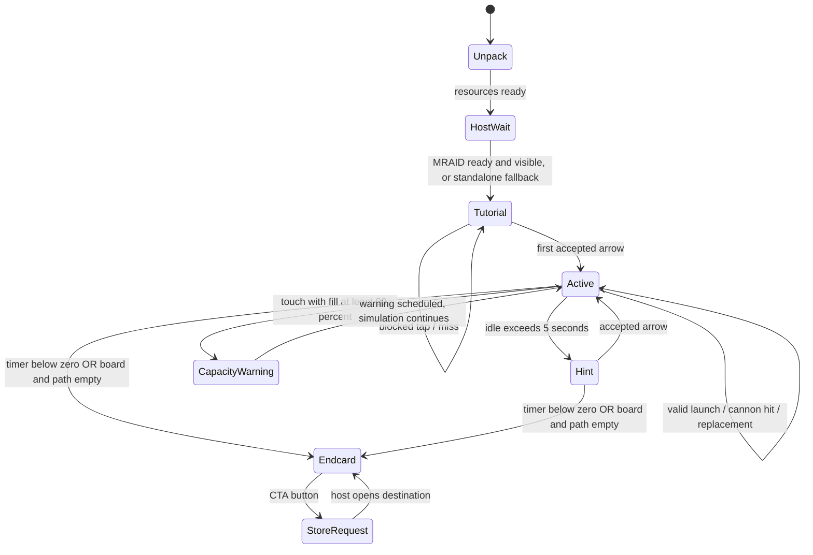

# Reference state model

**Confirmed:** the source uses booleans and per-object flags, not this enum. **Inferred:** the following Mermaid model summarizes those branches. Source: extracted/modules/GameManager.ts.js::start/onTouchEnd/update/restartTutorial/checkGameOver/activateCTA; Path.ts.js; Cannon.ts.js; Tunnel.ts.js. Runtime transitions are unobserved.

**Confirmed:** CapacityWarning is not a fail state and does not stop the timer. **Inferred:** the diagram's return to Active is conceptual; source only schedules color tweens. There is no coded restart transition. The endcard is UI state, not a complete simulation shutdown.

|Scope / from|Trigger / guard|Actions|To|Status / evidence|
|---|---|---|---|---|
|Host waiting|ready and viewable, one-time boot guard|Boot Cocos|Tutorial|Confirmed: outer-wrapper onSdkReady/viewable_start_ads|
|Initial tutorial|First accepted valid launch|Clear firstTouch; playBGM; CHALLENGE_STARTED; timer/hint enabled|Active|Confirmed: GM.onTouchEnd|
|Any tappable board|Closest collider has non-moving Arrow; lane clear; fill <90|Set moving/inTransit; create transit history; tween head|Concurrent launch|Confirmed: GM.onTouchEnd|
|Any board input|fill ≥90|Wrong SFX; red/white label tween|Same simulation state|Confirmed: GM.onTouchEnd|
|Stationary arrow|Blocked forward ray|Head nudge/bounce; wrong SFX|Stationary|Confirmed: GM.canArrowMove/onTouchEnd|
|Transit head|Head reaches entry|Reparent/register first block|Tail entering|Confirmed: GM.onTouchEnd callback|
|Transit tail|Preceding block advanced one spacing OR 0.5 s wall clock after head arrival|Add tail block to path|Tail entering|Confirmed: GM.update|
|Transit group|All segments registered on path|Clear inTransit; schedule highlight refresh; drop transit record|Shootable on path|Confirmed: GM.update|
|On-path block|Foreign block within spacing ahead|Clamp/stop progress|Waiting/moving next update|Confirmed: Path.updateSegmentsOnPath|
|Detector entry|Matching Block and !inTransit|Projectile and shrink over 0.1 s|Destroy pending|Confirmed: Cannon.onDetectionEnter/destroyBlock|
|Projectile complete|Ammo decremented to exactly zero|Destroy detector, emit cannon event|Replacement|Confirmed: Cannon.destroyBlock|
|Active cannon|Its color absent from all remaining board/path blocks|Emit cannon event regardless of ammo|Replacement|Confirmed: GM.cleanupCannons|
|Replacement|Event belongs to tunnel|Delete cannon; next tick slide queue 0.3 s; refresh labels/detectors|New front active|Confirmed: Tunnel.onCannonDestroyed|
|Active|Idle counter <0 and canIdle|Choose leftmost valid active-color arrow; show hand; disable idle recurrence|Hint|Confirmed: GM.restartTutorial; empty candidate list unsafe|
|Active / hint|Timer <0|Stop AudioManager; hide HUD; scale CTA 0.4 s; end flags|Endcard|Confirmed: GM.update/activateCTA|
|Board/path clearing|arrows.length==0 and blocksOnPath.length==0|Same CTA transition|Endcard|Confirmed: GM.checkGameOver|
|Endcard|CTA interaction|CTA_CLICKED; MRAID/open fallback|Store request|Confirmed: CTAButtonHandler.onStoreButtonClicked|
|Any running state|MRAID invisible|No explicit pause action in wrapper|Unchanged by this handler|Confirmed: outer viewableChangeHandler; engine background behavior Unknown|

**Unknown:** attainable win, distinct runtime fail appearance, exact engine callback ordering, behavior after CTA and when the hint candidate list is empty. Do not represent CHALLENGE_FAILED/RETRY analytics constants as state transitions without call-site evidence.
